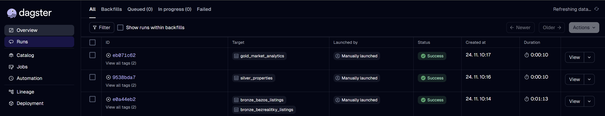
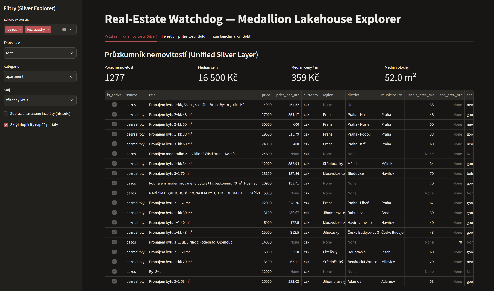

# Real-Estate Watchdog v2

[](https://github.com/libor-konopka/Real-Estate-Watchdog-v2/actions/workflows/ci.yml)


Asynchronous **Medallion Data Lakehouse** pipeline for monitoring, normalizing, deduplicating, and analyzing Czech real estate listings across multiple portals (**Bazoš** and **Bezrealitky**).

Built with **Python 3.14**, **Apache Iceberg**, **Project Nessie**, **MinIO**, **Polars**, **Pydantic v2**, **Dagster**, and **Streamlit**.

---

## Architecture Overview

```text
+--------------------+     +--------------------+
|   Bazos.cz (HTML)  |     | Bezrealitky (GQL)  |
| aiohttp+selectolax |     |   aiohttp POST     |
+---------+----------+     +---------+----------+
          |                          |
          +------------+-------------+
                       v
        +------------------------------+
        |   Pydantic v2 Validation     |
        | (Discriminated Union Models) |
        +--------------+---------------+
                       v
+----------------------------------------------+
| BRONZE LAYER (Apache Iceberg / MinIO S3)     |
| - bronze.bazos_properties                    |
| - bronze.bezrealitky_properties              |
| - Incremental fast-path & HTTP tombstones    |
+----------------------+-----------------------+
                       v
+----------------------------------------------+
| SILVER LAYER (Polars Vectorized Transforms)  |
| - silver.properties                          |
| - Postal code geo-enrichment                 |
| - Cross-portal Entity Resolution (Haversine) |
| - Lifecycle tracking & SHA-256 content hash  |
+----------------------+-----------------------+
                       v
+----------------------------------------------+
| GOLD LAYER (Analytical Data Marts)           |
| - gold.market_metrics (District benchmarks)  |
| - gold.investment_opportunities (Bargains)   |
+----------------------+-----------------------+
                       v
+----------------------------------------------+
| CONSUMPTION & ORCHESTRATION                  |
| - Dagster Assets, Jobs & Daily Schedule      |
| - Streamlit Interactive Explorer             |
+----------------------------------------------+
```

## Key Engineering Highlights

* **Strict Schema Contracts:** Uses Pydantic v2 discriminated unions (`BuildingProperty` vs. `LandProperty`) at the ingestion boundary and enforces explicit PyArrow schemas across all Medallion layers (`BRONZE_PROPERTY_ARROW_SCHEMA`, `SILVER_PROPERTY_ARROW_SCHEMA`, `GOLD_MARKET_METRICS_ARROW_SCHEMA`, `GOLD_INVESTMENT_OPPORTUNITIES_ARROW_SCHEMA`) before writing Parquet files to Apache Iceberg.
* **Incremental Extraction & Reconciliation:** Tracks active listing IDs and historical prices in Bronze to skip unchanged records (`fast-path`), while running concurrent `HEAD` reconciliation audits (`PortalReconciler` for both Bazoš and Bezrealitky) to emit deterministic SHA-256 tombstone records for deleted ads.
* **Cross-Portal Entity Resolution:** Identifies identical physical properties listed across multiple portals using spatial blocking keys, price/area tolerances, postal-code matching, and vectorized Haversine GPS distance calculation in Polars.
* **Open Table Format & Git-like Catalog:** Persists versioned Parquet datasets on S3-compatible **MinIO** managed by **Project Nessie** REST Catalog.

---

## Screenshots

### Orchestration & Asset Lineage (Dagster UI)


### Analytical Lakehouse Explorer (Streamlit)


## Project Structure

```text
Real-Estate-Watchdog-v2/
├── .github/workflows/
│   └── ci.yml                 # Automated Ruff, Mypy & Pytest CI pipeline
├── data/static/               # Reference lookup datasets (Czech postal codes)
├── docker/
│   └── docker-compose.yml     # MinIO (S3) + Project Nessie (Iceberg REST Catalog)
├── docs/images/               # Architecture & UI documentation screenshots
├── src/
│   ├── contracts/             # Pydantic v2 domain models, validators & PyArrow schemas
│   ├── orchestration/         # Dagster assets, jobs, schedules & definitions
│   ├── scrapers/              # Async HTTP scrapers, DOM/GraphQL parsers & reconciler
│   ├── storage/               # PyIceberg & Nessie catalog manager
│   ├── transformations/       # Bronze ingestion, Silver normalization & Gold marts
│   ├── config.py              # Pydantic Settings configuration
│   ├── dashboard.py           # Streamlit analytical dashboard
│   ├── main.py                # Standalone async CLI pipeline runner
│   └── verify_iceberg.py      # Infrastructure & Iceberg schema verification script
├── tests/                     # Pytest unit test suite
├── .env.example               # Environment configuration template
├── .gitignore                 # Git exclusion rules
└── pyproject.toml             # uv / PEP 621 project dependencies & tool config
```

---

## Quickstart

### 1. Prerequisites
* **Python 3.14+** and [`uv`](https://docs.astral.sh/uv/)
* **Docker** & **Docker Compose**

### 2. Configure Environment & Dependencies
```bash
cp .env.example .env
uv sync
```

### 3. Start Lakehouse Infrastructure (MinIO + Nessie)
```bash
docker compose -f docker/docker-compose.yml up -d
```
* **MinIO Console:** `http://localhost:9001` (`admin` / `password`)
* **Nessie REST Catalog:** `http://localhost:19120/iceberg/`

Verify catalog and table initialization:
```bash
uv run python -m src.verify_iceberg
```

### 4. Run the ELT Pipeline
**Option A — Dagster UI (Recommended):**
```bash
uv run dagster dev
```
Open `http://localhost:3000` and materialize `real_estate_lakehouse_job`.

**Option B — Standalone CLI Runner:**
```bash
uv run python -m src.main
```

### 5. Launch Streamlit Dashboard
```bash
uv run streamlit run src/dashboard.py
```

---

## Code Quality & Testing

Run static analysis, type checking, formatting checks, and unit tests locally:

```bash
uv run ruff check src tests
uv run ruff format --check src tests
uv run mypy src tests
uv run pytest -v
```
